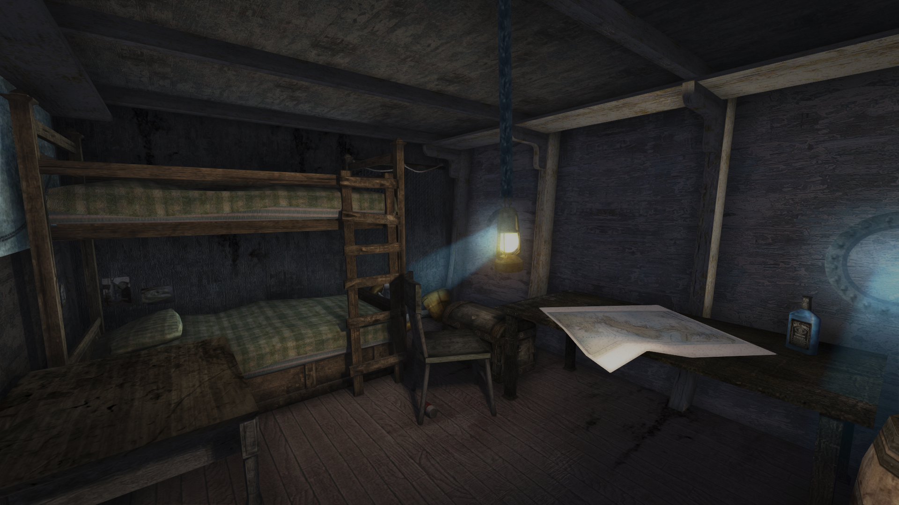
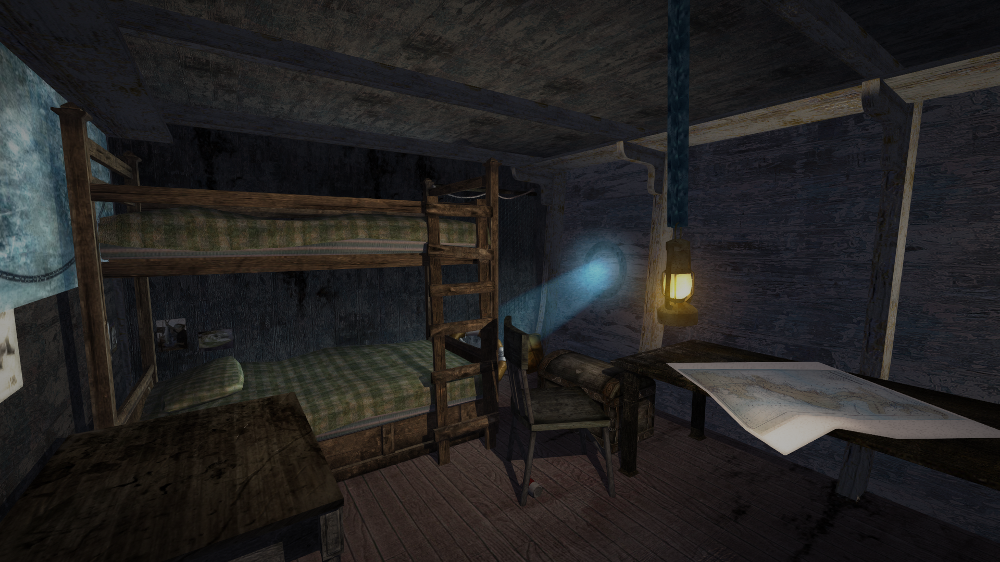
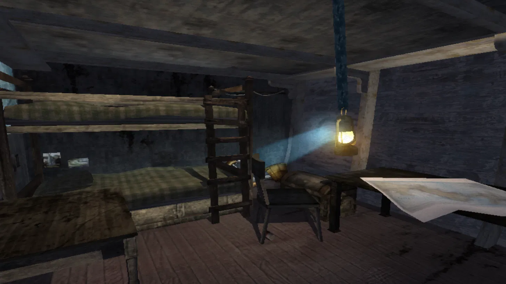

# Penumbra-d3d11
My little port from OpenGL to DirectX11

-809099?style=for-the-badge&labelColor=131313)

## How it's going
Ported HPL Engine 1 to native DirectX 11 `vs_5_0 / ps_5_0 HLSL shaders` with an `R16G16B16A16_FLOAT` HDR scene target the map still loads in 311 ms.

`Soft shadows, 4x MSAA, anisotropic filtering, FXAA, sharpening, HDR, GGX specular and SSAO D3D11`

  

`D3D11`

  
  
`OpenGL`

  

## Installation instructions
 
Make a copy of your installed `Penumbra: Overture` folder, for example `H:\redist` don't use your only copy.

Unzip PenumbraD3D11.zip and copy core and config as well as the other DLLs and `Overture.exe` as well as `materials.cfg` (Or just copy everything from the extracted folder to your game directory) when or if prompted choose replace for everything.

Make sure `materials.cfg` sits next to `resources.cfg.`

You can check your settings in `config\d3d11_overrides.cfg.`

Run `Overture.exe` and not `Penumbra.exe` since the old exe will error about missing DLLs.

## Log

Open `Documents\Penumbra Overture\Episode1\hpl.log`
  
## Frontier

- **Audio:** OpenAL output cuts out constantly
- **Physics:** behaves a bit off compared to the original
- **Shaders:** tuning the HLSL output

## Backend

- 5 classes implementing the engine's `iLowLevelGraphics`, `iTexture`, `iVertexBuffer`, `iGpuProgram` and `iOcclusionQuery` (about 5,200 lines).

## Shaders

- 51 HLSL files from 64 Cg originals the rest are old-GPU fallbacks and two-pass spot lights skipped.

- Compiled at runtime with `D3DCompile`; the engine still asks for `X.cg` and gets `X.hlsl`.

## License

Penumbra-d3d11 is primarily distributed under the terms of the zlib license. See [LICENSE](LICENSE) and [NOTICES.md](NOTICES.md) for 3rd party software and their licenses.
